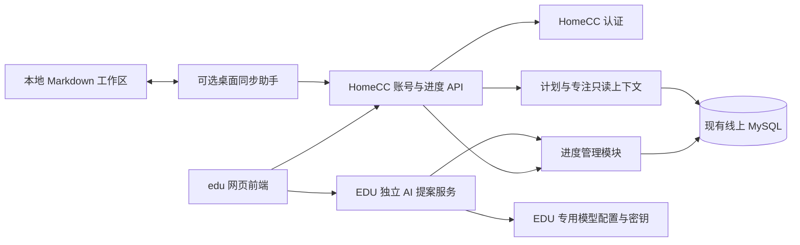

# 技术架构与接入计划

## 1. 目标架构

## 2. 前端

- 独立 Vue 3 + TypeScript 工程，和主站分别构建。
- 根路由 `/` 为教育门户；规划布局、状态和页面只在 `/planner` 下加载，具体路由见 `04-教育门户路由与多层规划.md`。
- 本地优先验证目标、计划版本、打卡和 AI 提案确认流程。
- API 基地址由环境变量提供；生产阶段才配置 `edu.combinecalculate.cn` 的静态部署与 API 跨域白名单。

## 3. 后端

- 在 `homecc-javaapi` 新增 `progress` 领域模块：实体、迁移、Repository、Service、Controller、DTO 和测试。
- 所有写接口从 JWT 获取当前用户，禁止由前端传入或替换归属用户 ID。
- EDU AI 提案服务使用独立接口、配置、密钥、模型白名单、配额和审计；不复用主站聊天路由、DeepSeek 默认配置或用户 AI 凭证体系。
- AI 只可读取经授权的进度上下文并生成结构化提案；应用操作仍由进度模块按用户确认结果执行。
- 计划应用使用幂等请求键和乐观锁，避免重复点击或多端同时操作产生重复计划版本。

## 4. 登录与 SSO

首期：Edu 前台使用现有 HomeCC 账号登录，保持独立会话。

后期：如需在主站与 Edu 间无感切换，先完善授权码流程：客户端注册、回调地址白名单、PKCE、短期授权码摘要化、会话失效和审计。当前账单用的简化 SSO 接口不直接扩展为浏览器 SSO。

## 5. 实施顺序

1. 创建前端工程骨架和本地页面信息架构。
2. 在 Java API 实现独立 `progress` 数据模型及基础 CRUD。
3. 完成手工计划、版本和打卡的端到端本地验证。
4. 优先完成本地变更包导入、差异预览、确认应用和网站导出；网站 API 生成提案随后接入同一流程。
5. 增加对现有任务和专注数据的只读关联。
6. 完成测试数据清理、生产配置收敛和子域名部署准备。

## 6. 已列入后续日程：桌面同步助手

跨设备网页数据先通过 HomeCC API 和线上数据库同步，不依赖桌面程序。需要在网页关闭后持续监听本地工作区、自动上传本地 AI 的提案或把云端变化写回目录时，再提供可选的轻量桌面同步助手。

桌面端优先采用 Tauri 等跨平台方案：同步状态机、哈希、队列、冲突检测和图校验共用一套核心；macOS 与 Windows 分别处理签名、安装包、目录权限、系统凭证、托盘和可选开机启动，不分别开发两套产品逻辑。它不复制规划网站界面，也不直接访问数据库，只通过 HomeCC API 工作。

计划顺序：

1. 完成稳定记录模型、目录协议和冲突语义。
2. 接入账号与网页云同步，验证两个浏览器间的增量往返。
3. 制作最小同步助手，只支持用户明确选择的目录、手动同步和状态展示。
4. 增加目录监听、离线队列、断点重试和托盘运行。
5. 接入本地 AI 变更提案，并在网站或助手中预览、部分采纳。

桌面助手属于增强能力；手动目录读写和网页云同步必须始终可独立使用。具体协议见 `05-本地工作区与网站同步.md`。
