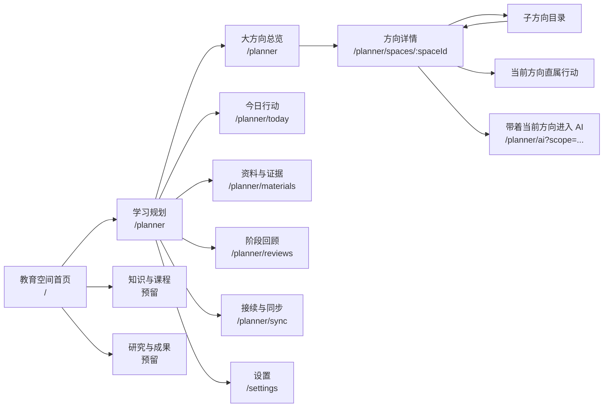
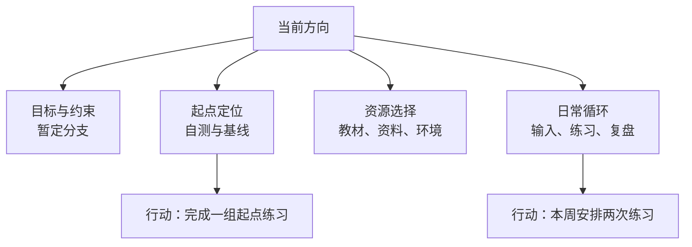
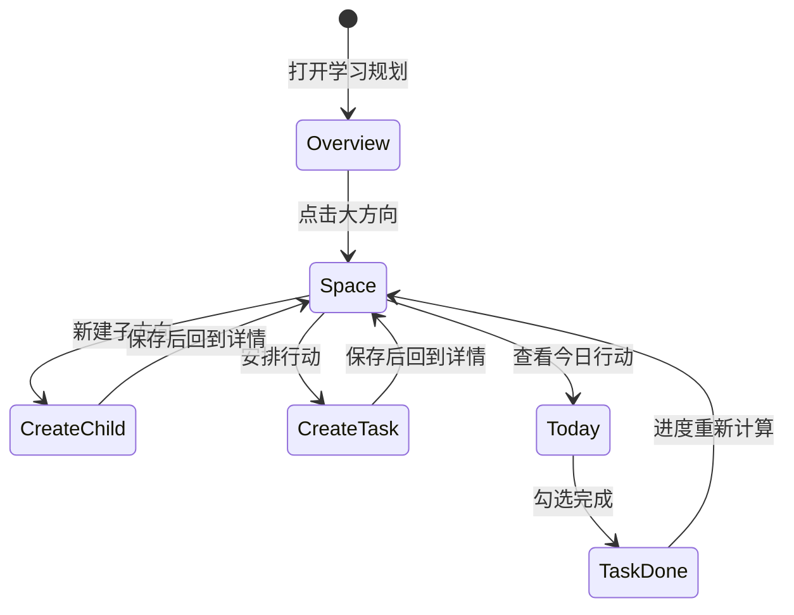
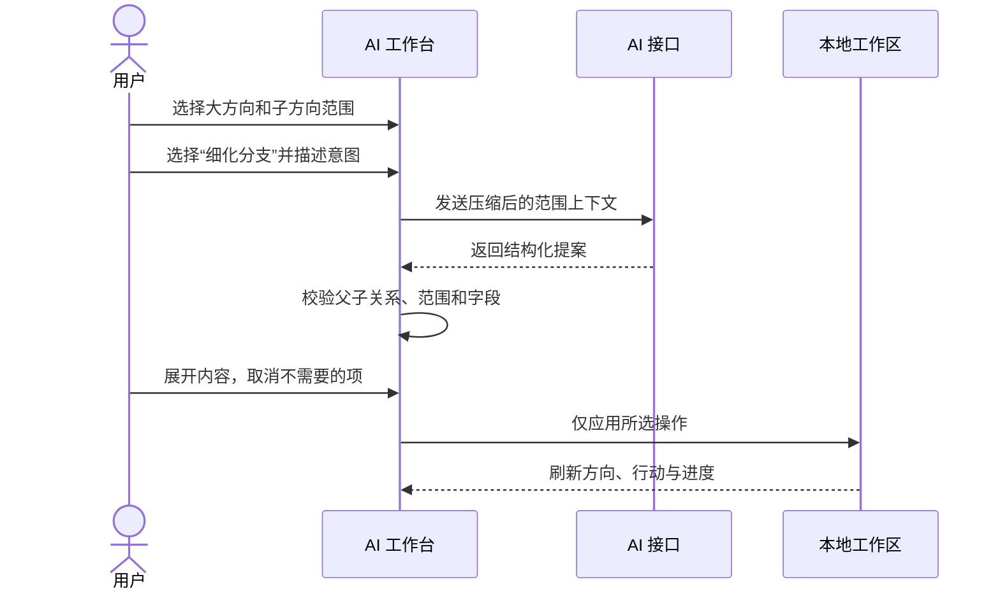

# 知序 EDU 原型图与页面线框

版本：v0.2 评审稿 · 2026-10-14  
用途：先确认信息结构和操作路径，再继续做视觉细节与线上数据接入。

这份文档描述的是“个人教育空间”这一层，不把规划工具误当作网站首页。根路由是未来教育门户，规划只是门户中的一个栏目。

## 一、产品骨架



### 页面分工

| 页面 | 用户在这里回答的问题 | 主要动作 |
| --- | --- | --- |
| 教育空间首页 | 我想进入哪一个学习空间？ | 进入学习规划，未来进入课程或研究 |
| 大方向总览 | 我现在有哪些长期方向？ | 新建大方向、进入方向详情、调整方向 |
| 方向详情 | 这个方向是怎样展开的？ | 创建子方向、安排行动、查看加权进度、让 AI 跟进 |
| 今日行动 | 今天实际要做什么？ | 完成行动、调整行动、把草稿转成行动 |
| AI 规划 | 我希望 AI 在什么范围内帮我做什么？ | 选择范围、选择模式、生成提案、逐项采纳 |
| 资料与证据 | 哪些资料和自述能帮助判断进展？ | 上传、记录、调整、删除 |
| 阶段回顾 | 这一阶段发生了什么？ | 生成、调整、删除回顾 |
| 接续与同步 | 如何把当前思路带到下一次讨论或另一台设备？ | 预览接续包、读写目录 |

## 二、总览页线框

总览页只承担“选择方向”的任务，不同时堆叠今日行动、草稿和 AI 提示。这样用户进入规划时先看到地图，再决定进入哪一块。

```text
┌──────────────────────────────────────────────────────────────────────┐
│ 知序 / EDU                 学习空间 / 学习总览              本地原型 │
├──────────────┬───────────────────────────────────────────────────────┤
│ 教育空间首页 │ 10 月 14 日 · 星期三                                  │
│              │ 我的 大方向                                            │
│ 学习总览  ●  │ 选择一个大方向，进入子方向目录，再安排具体行动。       │
│ 今日行动     │                                                           │
│ 资料与证据   │ ┌─────────────────┐  ┌─────────────────┐  ┌───────────┐ │
│ 阶段回顾     │ │ 研究能力         │  │ 日语学习         │  │ 英语表达  │ │
│ AI 规划      │ │ 0% · 3 子方向    │  │ 0% · 待确认       │  │ 100%      │ │
│ 接续与同步   │ │ [进入方向 →]     │  │ [进入方向 →]     │  │ [进入方向]│ │
│              │ │ 里程碑：……       │  │ 里程碑：……       │  │ ……        │ │
│              │ └─────────────────┘  └─────────────────┘  └───────────┘ │
│              │                                                           │
│              │ 大方向由你建立。进入方向后，可手工或让 AI 继续细化。    │
└──────────────┴───────────────────────────────────────────────────────┘
```

视觉重点：大方向卡片只保留标题、两行描述、进度、子方向数量和里程碑。长说明进入详情后再展开；编辑按钮和进入按钮分开，避免误操作。

## 三、方向详情页线框

详情页是整个系统的核心。上面回答“走到哪儿”，中间回答“还能怎样拆”，下面回答“当前实际做什么”。

```text
┌──────────────────────────────────────────────────────────────────────┐
│ 学习总览 / 日语学习（待确认）                                         │
│ 大方向 · 方向                                                         │
│ 日语 · 学习规划（待确认）                          [让 AI 跟进] [调整] │
│ 查看方向说明                                                          │
├──────────────────────────────────────────────────────────────────────┤
│ 当前进度  0%       ━━━━━━━━━━━━━━━      当前里程碑                    │
│ 0/2 个行动完成    [进度如何计算 ▾]       已自述……（可展开阅读）        │
├──────────────────────────────────────────────────────────────────────┤
│ 01 / BRANCHES  子方向 0                              + 新建子方向      │
│                                                                      │
│             这里还没有子方向。可以先拆出一个阶段、项目或分支。        │
│                 [创建第一个子方向]   [让 AI 细化分支]                  │
├──────────────────────────────────────────────────────────────────────┤
│ 02 / ACTIONS   当前方向的行动 2                       + 安排行动       │
│ □ 澄清学习目的、目标级别与可用时间       分量 5 · 难度 2 · 40 分钟  调整 │
│ □ 用样题或教材目录做起点定位自测         分量 4 · 难度 3 · 45 分钟  调整 │
└──────────────────────────────────────────────────────────────────────┘
```

当子方向存在时，空状态替换成两列或一列卡片：



分支命名遵循“职责清楚、同层同维度”。例如同一层可以都是能力分支，也可以都是阶段分支；不把“听力、N4、每天 30 分钟、教材 A”混成四种不同类型的卡片。

## 四、AI 工作台线框

AI 页不应该像聊天记录，而应该像一个“范围 + 意图 + 提案”的工作台。用户先约束范围，再告诉 AI 这轮要做什么，最后只采纳看得懂的操作。

```text
┌──────────────────────────────────────────────────────────────────────┐
│ AI PLAN STUDIO                                                        │
│ 把方向，细化成下一步。                                                │
│ 选择范围与目标，审阅具体调整，再决定是否采纳。                       │
├──────────────────────────────────────────────────────────────────────┤
│ 规划方式                                                             │
│ [细化分支] [调整计划] [评估进展] [先讨论]                             │
│                                                                      │
│ 大方向       [ 日语 · 学习规划（待确认）      ˅ ]                    │
│ 子方向范围   [ 整个大方向（包含下级）          ˅ ]                    │
│                                                                      │
│ 你希望怎样调整？                                                     │
│ ┌──────────────────────────────────────────────────────────────────┐ │
│ │ 请结合已有内容继续细化子方向……                                  │ │
│ └──────────────────────────────────────────────────────────────────┘ │
│ 将使用“标准”档上下文                               [生成调整提案]   │
├──────────────────────────────────────────────────────────────────────┤
│ 本轮建议  3 项                                                      │
│                                                                      │
│ ☑ 新增方向   听力起步（暂定）                                       │
│   归属 · 日语学习       分支职责和暂定依据……       [查看具体内容 ▾] │
│                                                                      │
│ ☑ 新增行动   听一段短音频并记录五处疑难                             │
│   归属 · 听力起步       产出、时长和完成标准……      [查看具体内容] │
│                                                                      │
│ ☐ 新增草稿   每周学习时间待确认                                    │
│   归属 · 日语学习       保留待讨论问题……             [查看具体内容] │
│                                                                      │
│                         [放弃本次提案] [采纳所选 2 项]                │
└──────────────────────────────────────────────────────────────────────┘
```

### 提案展示原则

1. 标题显示用户看得懂的名称，不显示 UUID；内部 ID 仍只用于应用操作。
2. 每项显示归属、理由和具体内容；正文默认折叠，避免一屏被长文本淹没。
3. 新行动要写清楚“做什么、产出什么、预计多久、怎样算完成”。
4. 单纯询问进展时，AI 可以只给总结，不强行创建回顾或修改方向。
5. 新分支和行动可以在同一批提案中建立；漏选父分支时，错误显示在具体子项旁边。

## 五、关键操作流程

### 手工细化



### AI 细化与采纳



## 六、移动端线框

移动端不缩小桌面页面，而是把侧栏收成菜单，把卡片改成单列，把 AI 范围选择器改为全宽弹层。

```text
┌────────────────────────────┐
│ ☰  学习空间 / 日语学习     │
├────────────────────────────┤
│ 日语 · 学习规划             │
│ 0%                         │
│ ━━━━━━━━━━━━━              │
│                            │
│ 子方向 0                   │
│ ┌────────────────────────┐ │
│ │ 这里还没有子方向       │ │
│ │ [创建] [让 AI 细化]    │ │
│ └────────────────────────┘ │
│                            │
│ 当前行动 2                 │
│ □ 澄清学习目的       调整  │
│ □ 起点定位自测       调整  │
│                            │
│ [今日行动] [AI 规划]       │
└────────────────────────────┘
```

移动端选择器的最小交互：点击打开、输入搜索、上下键切换、Enter 选择、Esc 关闭；弹层不能超出视口，也不应改变页面横向宽度。

## 七、评审重点

先看下面四件事是否符合你想要的使用感觉：

- 进入规划时，是否应该先看到“大方向卡片”，而不是马上看到行动？
- 方向详情中，“子方向”和“行动”的上下关系是否足够直观？
- AI 提案是否需要保留“先讨论”模式，让它只回答而不生成操作？
- 进度评估是否应该在方向详情显示，还是单独放到阶段回顾？

这份原型稿确定后，下一步再把它拆成视觉规范、组件规范和可操作的页面迭代清单。
