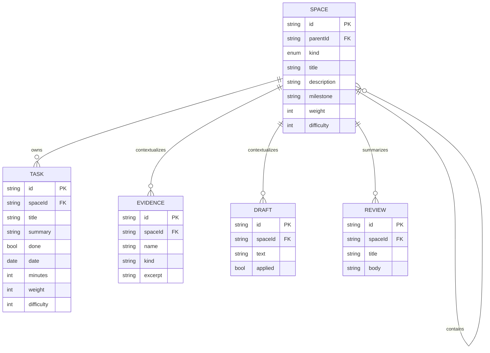
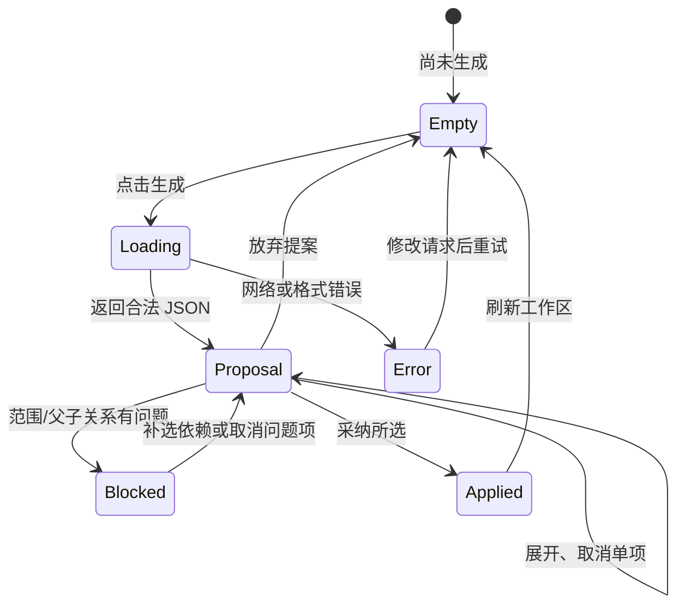

# 知序 EDU 交互与字段规格

版本：v0.2 评审稿 · 2026-10-14

这份文档把线框中的动作落到可实现的字段和状态上，避免后续页面看起来漂亮，但数据归属和 AI 提案无法稳定应用。

## 一、规划树字段



`spaceId` 对资料、草稿和回顾是可选的。没有归属的内容属于整个工作区。资料现已支持按方向绑定：AI 子范围读取本范围及下级资料，同时参考上级资料库，可选带入总文件库；草稿和回顾仍按本范围筛选。修改权限仍限定在所选方向内。`id` 只做稳定关联，不直接展示给用户。详见 [资料库与 Markdown 本地保存](./18-资料库与Markdown本地保存.md)。

## 二、字段如何显示

| 字段 | 页面显示方式 | 编辑方式 | 约束 |
| --- | --- | --- | --- |
| `title` | 卡片标题或行动标题 | 直接编辑 | 必填，避免用 ID 代替 |
| `description` | 方向说明，默认折叠 | 方向编辑 | 只描述长期目的和必要约束 |
| `milestone` | 里程碑短句 | 方向编辑 | 一句话、可完成、可检查 |
| `kind` | 方向、计划、阶段、项目、分支 | 选择器 | 同层尽量保持同一分类维度 |
| `weight` | 分量 1–100 | 数字输入 | 表示同层相对分量，不是完成百分比 |
| `difficulty` | 难度 1–5 | 短选项 | 表示完成难度，不代表能力等级 |
| `summary` | 行动记录，默认短摘要 | 文本框或导入文件 | 记录产出、问题和下一步线索 |
| `done` | 勾选完成 | 复选框 | 代表执行记录，不自动推断能力掌握 |

## 三、AI 意图

| 意图 | 默认操作 | 不应自动做的事 |
| --- | --- | --- |
| 细化分支 | 建立 2–4 个职责清楚的暂定分支，安排少量起步行动 | 不凭空创建大方向，不塞满所有问题 |
| 调整计划 | 复用并调整已有方向、行动和日期 | 不重复创建澄清、自测、汇总类元行动 |
| 评估进展 | 先在 `summary` 里直接回答已推进、当前阶段、下一步 | 不因缺少总结而否定完成，不默认新增回顾 |
| 先讨论 | 只返回建议或问题，`operations` 可以为空 | 不修改任何工作区记录 |

评估文字的推荐结构：

```text
现在：一句话说明已经推进到哪一步。
已经推进：最多列 2–3 项用户能认出的行动名称。
下一步：一个具体行动，包含建议时长或产出。
需要确认：最多一个会改变计划的问题。
```

## 四、选择器规范

方向、上级方向和 AI 范围使用层级选择器：

- 顶部显示当前名称和所属路径；
- 打开后可以搜索标题或上级路径；
- 当前项有勾选标记；
- 空结果给出可理解的提示；
- 键盘支持上下、Enter、Esc，Tab 会关闭弹层并进入下一个表单字段；
- 移动端弹层不能超出视口；
- 难度、类型、颜色和接口协议等短选项继续使用统一样式的原生选择框。

## 五、提案应用状态



应用前必须检查：

1. 所有更新和删除目标仍然存在；
2. 新行动所属方向存在；
3. 同批新分支可以被同批行动引用；
4. 所有操作都在选择范围内；
5. 不出现把节点放进自己或下级的循环；
6. 用户只采纳勾选项。

## 六、完成标准

当一个行动被标记完成时，系统只更新执行记录和加权进度。能力评估必须依靠练习结果、作品、测试或用户明确反馈；页面需要把“执行进度”和“能力证据”分开显示。

当一个方向没有子方向时，页面必须同时提供手工创建和 AI 细化两个入口；AI 生成的分支默认标注暂定依据，用户仍可以调整、删除或重新归类。
